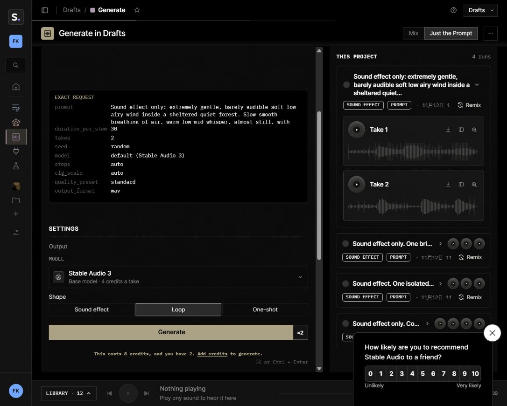
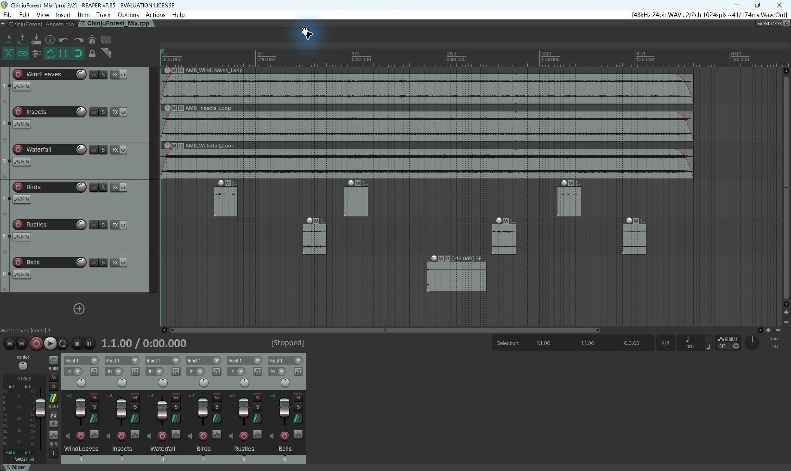
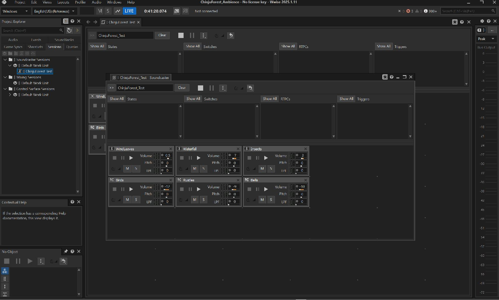
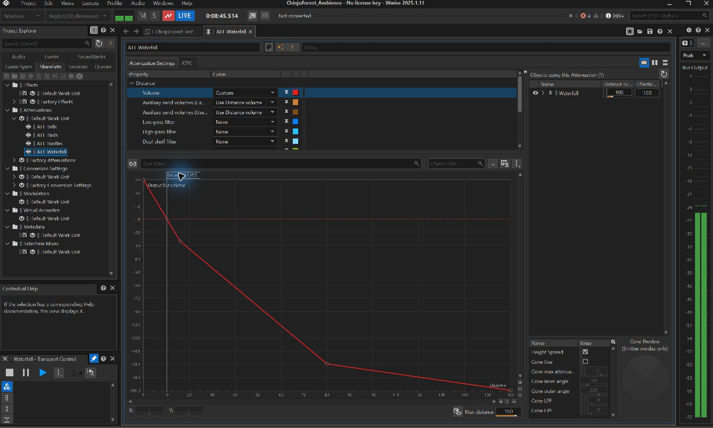
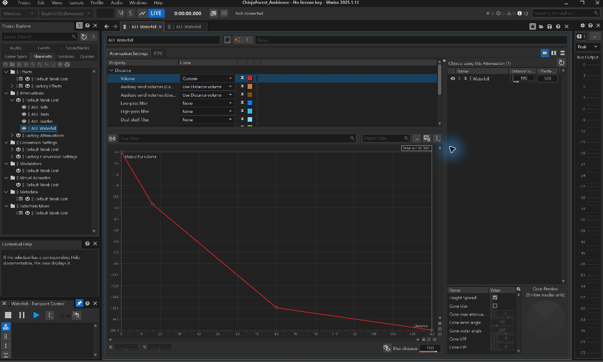

# 镇守之森环境声音设计说明

## 1. 场景选择与听觉目标

我选择《原神》稻妻的镇守之森作为这次环境声设计的对象。吸引我的是古树、石阶、鸟居、石灯笼和蓝色微光组合出的幽静感。声音希望偏向哀怨、轻柔和孤寂，让人感到森林很深，同时保留少量自然活动。

图 1　镇守之森场景参考。图片来自 HoYoLAB 用户 Reinfactor 发布的游戏截图，画面署名 Rexorcion，原有署名保留。来源：https://www.hoyolab.com/article/20156776 。图片仅用于说明设计对象，游戏及图片权利归相应权利人，并非本人拍摄。

我的思路是先建立安静的环境底色，再加入少量前景细节。近处的草丛要短、细，鸟鸣分散在中景，流水和铃音退到远处。风声不做成强风，虫鸣不做成热闹的夏夜，鸟鸣也不密集出现。铃音只保留单次敲击与尾响，不承担旋律音乐的作用。瀑布和铃音是画面外的创意声源，不能从这张参考图直接确认。

| 声音层 | 正式文件与数量 | 时长 | 设计作用与播放方式 |
|---|---|---|---|
| 微风与树叶 | AMB_WindLeaves_Loop.wav，1 条 | 60 秒 | 全局循环，轻柔的空气流动与少量叶声 |
| 远处流水 | AMB_Waterfall_Loop.wav，1 条 | 60 秒 | 循环、3D 衰减，提供远景纵深 |
| 细微虫鸣 | AMB_Insects_Loop.wav，1 条 | 60 秒 | 全局循环，衬托寂静 |
| 零星鸟鸣 | SFX_Bird_01/02/03.wav，3 条 | 各 4 秒 | 随机播放，少量自然生机 |
| 草丛窸窣 | SFX_Rustle_01/02/03.wav，3 条 | 各 4 秒 | 随机播放，近处活动细节 |
| 日式铃音 | SFX_Bell_01/02/03.wav，3 条 | 各 10 秒 | 低密度随机播放，表现清冷与孤寂 |

## 2. 确定设计对象与收集素材的过程

这次采用 AI 生成与现成自然录音混合制作。AI 用于比较容易描述动作和情绪的风声、草丛和铃音；真实录音用于补充流水、虫鸣和鸟鸣的自然细节。没有使用游戏原声，也没有进行野外实录。AI 辅助了提示词、处理脚本、工程配置与整理，我主要确定声音方向、判断样音是否合适，并根据试听提出修改要求。

生成工具使用 Stable Audio 官方网页，实际模型标签为 `default (Stable Audio 3)`。采用标准质量，随机种子为 random，steps 与 cfg_scale 为 auto；页面未提供实际种子数值。草丛生成 4 秒 × 3，铃音生成 10 秒 × 3，轻柔风声生成 30 秒 × 2。连同弃用的首批风声，四批共消耗 48 个免费积分，支出为 0 元。实际请求完整保存在 `Evidence/generation_requests.json`。

图 2　Stable Audio 实际生成页面。截图用于记录工具与生成结果；采用的请求以 JSON 中的完整英文提示词为准。

风声提示词强调 sheltered quiet forest、barely audible、almost still、occasional faint leaf rub，并排除雨、水流、密集沙沙声、音乐和人声。草丛强调小动物轻擦草叶的一次短促动作；铃音强调旧日式铜铃的单次轻敲、柔和起音与较长的清冷余响，避免连续叮当或旋律。

自然录音来自两个标注 CC0 的页面。Thimras 的 Park ambiences 提供河流与鸟鸣，录于澳大利亚阿德莱德；Wolfgang_ 的 Crickets Ambient Noise - loopable 提供虫鸣。三个鸟鸣文件是不同录音选段，不能据此声称是三种鸟。河流录音经处理后作为远处瀑布的听觉替代，也不应描述成现场瀑布实录。

- 公园河流与鸟鸣：https://opengameart.org/content/park-ambiences
- 虫鸣：https://opengameart.org/content/crickets-ambient-noise-loopable
- CC0 说明：https://creativecommons.org/publicdomain/zero/1.0/
- Stable Audio 使用授权：https://kb.stability.ai/knowledge-base/stable-audio-commerical-and-usage-licensing

选用源文件保存在 `Sources/`，完整来源、下载入口、积分和格式记录见 SOURCES.md。AI 下载源实际为 44.1 kHz、16 bit 双声道，后续转换成课程要求的规格；升采样和增加位深不会凭空增加源录音的信息量。

## 3. 剪辑素材与导出资产的过程

处理时先选取相对干净的部分，再做去直流、高低通滤波、音量调整与淡化。河流选取原录音 30—100 秒，削弱低频隆隆声和高频近景感；鸟鸣选取彼此分离的三个 4 秒片段，削弱不需要的环境底噪。虫鸣保留较细的高频质感，但降低整体音量。三个环境层均制作成 60 秒，循环接缝使用 0.5 秒交叉淡化。

风声是修改最多的部分。首批听起来太杂，接近雨声，不符合安静森林的目标。重新生成后，我又提出“再轻一些、叶声更少”。最后采用第二批 Take 1 的 1—5.5 秒与 18.5—23.5 秒，以 0.25 秒交叉淡化连接，使用 45 Hz 高通、1100 Hz 低通，并将 RMS 上限降至 -33 dBFS。这样空气声更轻，叶声也不会一直抢注意力。

草丛保留短促摩擦的变化，处理起止点，避免突然截断。铃音保留金属起音和自然衰减，文件末尾做淡出，不把尾响硬切掉。滤波、选段与淡化由 FFmpeg 和 Python 辅助完成，参数保存在 `Audio_Edit/edit_decisions.json`。REAPER 7.85 用于实际载入媒体、六轨编排与最终混音导出，工程使用相对路径。

图 3　REAPER 中实际打开的六轨混音。三个环境底层持续铺设，鸟鸣、草丛和铃音间隔出现，整体使用淡入淡出。

正式资产共十二个，统一为 48 kHz、24 bit、双声道 PCM WAV。九十秒试听由 REAPER 原生导出：风、虫、水构成连续底层，鸟鸣安排在约 9、31、67 秒，草丛在 24、56、78 秒，铃音在 45 秒。它用于展示固定的声音编排；Wwise 内的随机播放另行测试。

自动检查确认十二个文件数量、时长、采样率、位深与声道满足要求，无削波和整段静音。九十秒混音峰值约 -9.77 dBFS，RMS 约 -28.81 dBFS，保留了一定余量。最终试听后，风声与叶声的轻重基本合适，整体方向确定为哀怨轻柔。十分钟引擎记录用于核对播放逻辑，不能代替人耳对循环接缝的逐次判断。

## 4. 使用 Wwise 的情况

工程使用课程指定的 Wwise 2025.1.11.9262，英文名称为 `ChinjuForest_Ambience`。在 ChinjuForest 总容器下建立 WindLeaves、Waterfall、Insects、Birds、Rustles、Bells 六层。三个持续层无限循环，分层控制音量；三组随机层各装入三个文件，采用 Random Container 的 Shuffle 连续模式，避免紧邻重复。

| 层 | 容器音量 | 播放结束后随机等待 | 首次延迟 | 最大预览距离 |
|---|---|---|---|---|
| WindLeaves | -0.5 dB | 持续循环 | 0 | 全局 |
| Waterfall | -7 dB | 持续循环 | 0 | 160 米 |
| Insects | -3 dB | 持续循环 | 0 | 全局 |
| Birds | -12 dB | 12—25 秒 | 8—15 秒 | 60 米 |
| Rustles | -9 dB | 18—35 秒 | 15—25 秒 | 15 米 |
| Bells | -10 dB | 45—80 秒 | 30—50 秒 | 120 米 |

这些等待时间从文件播完后计算。铃音十秒的文件还会占用播放时间，所以不会每隔四十五秒必定响一次。首次延迟错开，避免场景开始时三组声音同时出现。瀑布及三组随机声开启 3D 定位和衰减，最大距离的 0%、10%、50%、100% 分别设为 0、-3、-18、-60 dB。

图 4　保存的 ChinjuForest_Test 会话，六个模块分别试听各层。工程另有总场景 Play_ChinjuForest、Stop_ChinjuForest 及六个分层 Play 事件。单独试听和总场景同时开启会叠加，需要避免重复播放。

通过官方 WAAPI 配置并记录参数，WwiseConsole 工程校验通过。完整场景在实际 Authoring 引擎中连续采样 604.92 秒，共 1194 次快照。每次快照均能观察到三个持续环境层的非虚拟声部，九个随机变体全部出现。估计的播放后等待为鸟鸣 12.275—24.474 秒、草丛 20.316—34.577 秒、铃音 60.015—76.386 秒，均符合设定范围。采样粒度约 0.5 秒，判断允许 0.8 秒误差，排除首个不完整间隔。初始延迟核对了保存配置，本次未测首个触发的精确时间。停止事件执行两秒后，场景 transport 停止且无残留声部。

图 5　瀑布近距离预览，距离游标约 10 米。

图 6　瀑布远距离预览，距离游标为 160 米。与近距离相比，输出电平明显降低。

另外注册独立声源与监听器，改变实际坐标并读取 Voice Inspector 的声部贡献。瀑布在 0、16、80、160 米的总增益约为 -7、-10、-25、-67 dB；鸟鸣、草丛和铃音在相同比例距离也分别得到 0、-3、-18、-60 dB 的相对衰减，数值误差小于 0.02 dB。界面预览与引擎数值相互核对，说明距离变化确实影响了音量。

## 5. 对作品的自我评价

我比较满意的是声音密度的控制。前两次风声并不理想，继续减少叶声、削弱高频和降低音量以后，才更接近我希望的哀怨轻柔感。铃音采用长等待，鸟鸣与草丛也留出空白，环境不会一直有声音事件抢占注意力。这次让我体会到，环境声设计需要主动做减法，素材多并不代表场景更有层次。

作品也有明确的限制。鸟鸣来自澳大利亚公园，适合本次氛围原型，但不能当作日本森林生态的准确复原。流水是河流录音加工，铃音是创意声源。当前完成的是 Wwise Authoring 内的原型，尚未接入游戏关卡；米制距离、方位和真实移动声源仍需在游戏中结合尺度继续调整。AI 对提示词的遵循也不稳定，生成后依然需要筛选、编辑和试听。

课程工程、声音来源和处理参数都已保留，便于复核。本次实践把平时调研中的生成式音频思路落实为可播放、可调整的资产与中间件工程，也让我理解了采样规格、循环、随机调度和空间衰减分别解决什么问题。

## 6. 完整提交入口

- 期末作品与工程：https://github.com/kirito-firefly/SHU-Game-Audio-Practice/tree/main/Final
- 九十秒试听：https://github.com/kirito-firefly/SHU-Game-Audio-Practice/blob/main/Final/Preview/ChinjuForest_90s.wav
- 平时调研：https://github.com/kirito-firefly/SHU-Game-Audio-Practice/blob/main/Task/AIGC_Game_Audio_Research.md
- 素材来源：https://github.com/kirito-firefly/SHU-Game-Audio-Practice/blob/main/Final/SOURCES.md
- 测试记录：https://github.com/kirito-firefly/SHU-Game-Audio-Practice/blob/main/Final/TESTING.md

打开工程时保留 Final 文件夹结构。Wwise 从 Events 试听总场景，并用 Stop_ChinjuForest 停止；Soundcaster 六个模块用于分层检查。REAPER 的 Mix 工程用于固定编排试听，Assets 工程用于十二个正式资产的对照检查。
